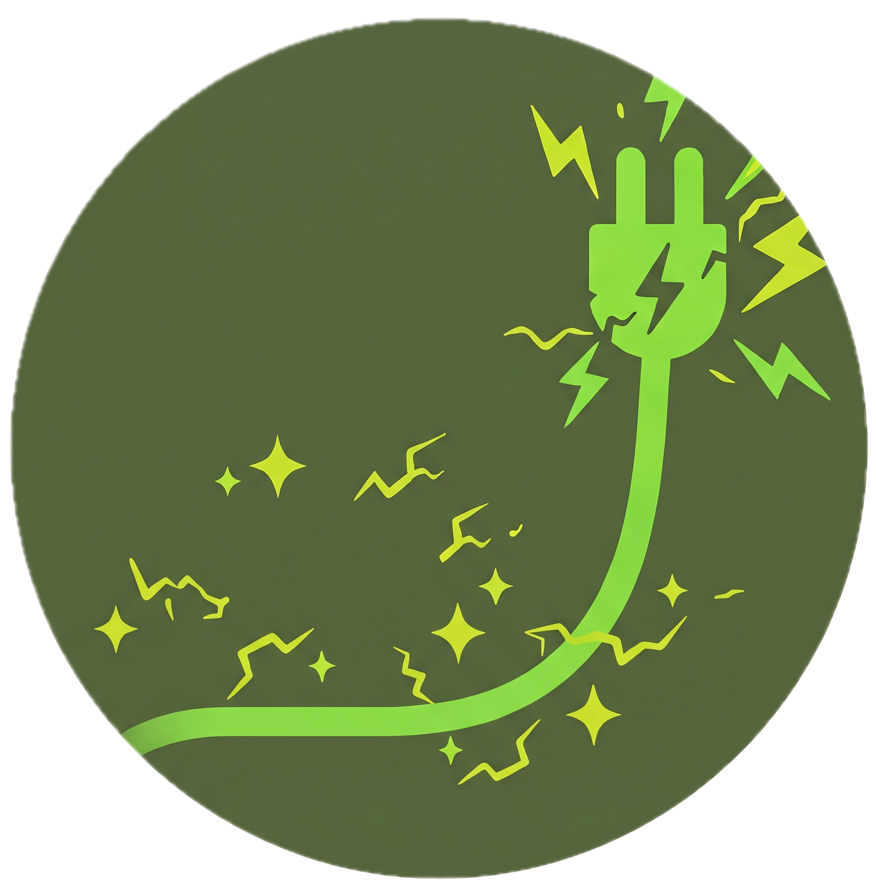
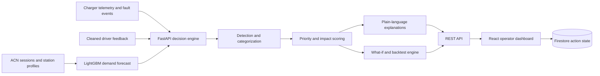

<div align="center">
  

  # AmpWise

  **Predict EV charging problems early. Prioritize the response. Keep every charge moving.**

  [](https://www.aihackerdorm.com/events/dormathon-2026-malaysia-s-nationwide-hackathon-build-the-next-big-thing)
  [](https://ampwise.vercel.app)

  [](frontend/package.json)
  [](frontend/tsconfig.json)
  [](backend/app/main.py)
  [](render.yaml)
  [](ml/model/model1_lgbm.txt)

  [Live application](https://ampwise.vercel.app) · [API documentation](https://portpulse-ampwise-api.onrender.com/docs) · [API contract](docs/api_contract.md)
  <!-- When the pitch deck is ready, add: · [Pitch deck](YOUR_SLIDE_URL) -->
</div>

## Live deployment

| Service | Deployment | Status |
| --- | --- | --- |
| **Application** | [ampwise.vercel.app](https://ampwise.vercel.app) | Live on Vercel |
| **Backend API** | [portpulse-ampwise-api.onrender.com](https://portpulse-ampwise-api.onrender.com/api/health) | Live on Render |
| **Interactive API docs** | [OpenAPI / Swagger UI](https://portpulse-ampwise-api.onrender.com/docs) | Available |
| **Action-state storage** | Firebase Firestore | Connected through the backend |

> **Pitch deck:** A presentation link can be added to the quick links above when the slides are ready.

## Overview

AmpWise is an AI-assisted decision platform for EV charging network operators. It combines demand forecasting, charger telemetry, fault events, and driver feedback to identify emerging operational risks before they become expensive failures.

The platform does more than surface predictions. It turns them into a ranked, explainable action list: what is wrong, why it matters, what to do next, how urgently to act, and what operational impact the intervention could have.

AmpWise was built for **DORMATHON 2026 — Track 1: Predictive Model Track**, whose core question is:

> Does your model help someone make a better decision, and can you prove it?

## The problem

EV charging operators receive fragmented signals from forecasts, station telemetry, fault logs, and user reports. A dashboard may show that something is abnormal, but operators still have to decide:

- Is this a safety fault, a damaged connector, congestion, or persistent under-capacity?
- Which issue should be handled first?
- How many sessions and how much revenue may be at risk?
- Will repairing a charger or adding capacity materially improve the outcome?

AmpWise closes that decision gap for an **EV charging network operator**.

## From prediction to action

| Stage | What AmpWise does | Operator outcome |
| --- | --- | --- |
| **Detect** | Forecasts arrivals and waiting time; detects charger faults and repeated driver complaints | Problems become visible before the next demand peak |
| **Categorize** | Distinguishes safety faults, degraded chargers, connector faults, user-reported failures, congestion, chronic under-capacity, and underuse | The operator understands the type of intervention required |
| **Prioritize** | Places safety first, then ranks every other issue by estimated revenue at risk, with the number of driver reports as the tie-breaker; each action also carries an urgency and a deadline | Limited technician capacity is directed to the highest-impact work |
| **Explain** | Produces plain-language reasons, sensor evidence, event history, and concrete recommended actions | Non-specialists can act with confidence |
| **Prove** | Runs repair/capacity what-if simulations and replays historical weeks against a baseline strategy | Decisions can be evaluated before deployment |

## Key capabilities

- **Network overview** — monitor energy delivered, active stations, live sessions, uptime, feedback themes, and recent alerts.
- **Predictive map** — compare station availability and forecast waiting time across the network.
- **Charger evidence** — inspect health history, fault probability, power delivery, telemetry evidence, fault messages, and driver reports.
- **Ranked action center** — sort operational issues by safety, estimated financial impact, urgency, deadline, and report volume.
- **Decision explanations** — show a human-readable reason for every alert; optionally generate multilingual advice through an LLM, with deterministic templates as a fallback.
- **What-if analysis** — estimate the change in average wait and served-session revenue after repairing a charger or adding capacity.
- **Historical backtesting** — compare AmpWise prioritization with the observed repair baseline using queue minutes, estimated revenue protection, forecast MAE, precision, and recall.
- **Operational persistence** — assign and complete actions through Firestore without exposing database credentials to the client.
- **Scenario replay** — switch between four data-selected moments: safety faults, most chargers down, weekday morning rush, and a quiet Sunday.

## Architecture



The prediction and decision layers remain separate: the ML model forecasts demand, while deterministic backend services calculate queueing, classify issues, estimate impact, rank actions, and validate any optional LLM-generated advice.

## Model and data

The included prototype replays a historical **ACN California (Caltech/JPL)** evaluation window from 30 November 2019 to 29 February 2020. The converted demo data contains four forecasted stations, charger telemetry, fault labels, and cleaned driver feedback.

The demand model uses station, calendar, lag, rolling-demand, charger-capacity, and weather features to produce a 24-hour forecast. On the held-out evaluation data:

| Evaluation slice | AmpWise MAE | Same-slot-last-week MAE | Improvement |
| --- | ---: | ---: | ---: |
| All 17,472 half-hour slots | 0.4151 | 0.5183 | 19.9% |
| Weekday daytime | 0.7566 | 0.9905 | 23.6% |
| Holiday and adjacent days | 0.3625 | 0.5345 | 32.2% |
| Busiest 10% of slots | 1.0896 | 1.5152 | 28.1% |

Metrics are stored in [`ml/output/model1_metrics.json`](ml/output/model1_metrics.json). The dashboard's backtest also reports decision-level outcomes rather than treating forecast accuracy as the final result.

## Quick start

### Prerequisites

- Python 3.12
- Node.js 22+
- npm

### 1. Clone the repository

```powershell
git clone https://github.com/Lynn662312/AmpWise.git
cd AmpWise
```

### 2. Start the API

```powershell
cd backend
py -3.12 -m venv .venv
.\.venv\Scripts\Activate.ps1
pip install -r requirements.txt
Copy-Item .env.example .env
uvicorn app.main:app --reload
```

The API is available at `http://localhost:8000`, with interactive documentation at `http://localhost:8000/docs`.

### 3. Start the frontend

Open a second terminal from the repository root:

```powershell
cd frontend
npm ci
Copy-Item .env.example .env
npm run dev
```

Open `http://localhost:5173`. The supplied environment example connects the frontend to the local API and uses the converted ML data.

> **Note:** Firestore is optional for local development. Without Firebase Admin credentials, set `VITE_ACTION_STATUS_ENABLED=false` in `frontend/.env`; forecasting, prioritization, explanations, simulations, and backtesting still work.

## Configuration

### Backend — `backend/.env`

| Variable | Purpose | Default behavior |
| --- | --- | --- |
| `MOCK` | Select fixed contract examples (`1`) or converted ML data (`0`) | `0` |
| `DATA_DIR` | Directory containing backend-ready Parquet/JSON files | `./data` |
| `CORS_ORIGINS` | Comma-separated allowed frontend origins | Local and deployed frontend |
| `LLM_API_KEY` / `LLM_MODEL` | Optional provider credentials for generated advice | Deterministic template advice |
| `FIREBASE_CREDENTIALS` | Optional service-account path or JSON for action-state persistence | Persistence disabled |

### Frontend — `frontend/.env`

| Variable | Purpose | Recommended local value |
| --- | --- | --- |
| `VITE_API_BASE_URL` | FastAPI base URL | `http://localhost:8000/api` |
| `VITE_DATA_MODE` | Use the API or local sample JSON | `api` |
| `VITE_ACTION_STATUS_ENABLED` | Show assign/complete controls | `false` without Firebase; otherwise `true` |

Never commit `.env` files or service-account credentials.

## Verification

Run the backend test suite:

```powershell
cd backend
.\.venv\Scripts\python.exe -m pytest -q
```

Validate and build the frontend:

```powershell
cd frontend
npm run check:data
npm run build
```

Run the ML preprocessing test after installing `ml/requirements.txt`:

```powershell
python -m pytest ml/tests -q
```

## API surface

| Method | Endpoint | Purpose |
| --- | --- | --- |
| `GET` | `/api/meta` | Dataset range, assumptions, demo times, and backtest weeks |
| `GET` | `/api/overview` | Network summary and energy trend |
| `GET` | `/api/stations` | Station status, working chargers, and predicted wait |
| `GET` | `/api/stations/{id}/forecast` | Half-hour demand and waiting-time forecast |
| `GET` | `/api/stations/{id}/chargers` | The station's chargers and their current status |
| `GET` | `/api/chargers/{id}/health` | Charger health history and evidence |
| `GET` | `/api/chargers/{id}/events` | Fault messages and driver-report timeline |
| `GET` | `/api/actions` | Ranked, explainable intervention list |
| `POST` | `/api/actions/{id}/advice` | Template or optional LLM-assisted action guidance |
| `PATCH` | `/api/actions/{id}/status` | Persist assignment/completion state |
| `POST` | `/api/whatif` | Simulate repair or added capacity |
| `GET` | `/api/backtest` | Compare AmpWise with the historical baseline |
| `GET` | `/api/reports/categories` | Driver complaint categories for the feedback chart |
| `GET` | `/api/health` | Service status |

See the complete bilingual [`docs/api_contract.md`](docs/api_contract.md) for request and response schemas.

## Suggested three-minute demo

1. Select **Safety faults** from the simulated-time menu to establish the operational risk.
2. Use the **Map** to show network-wide forecast congestion and charger availability.
3. Open **Actions** to demonstrate safety-first, impact-aware prioritization and its plain-language reasoning.
4. Inspect the affected charger's sensor evidence, event history, and driver reports.
5. Run **What-if** to quantify the value of repairing the charger now.
6. Finish on **Results** to compare forecast accuracy and operational outcomes against the baseline.

## Repository structure

```text
AmpWise/
├── frontend/          React, TypeScript, Vite, Tailwind CSS, Recharts, Leaflet
├── backend/           FastAPI application, decision services, tests, and converted data
├── ml/                Forecast notebook, LightGBM model, preprocessing, outputs, and tests
├── firebase/          Firestore security rules
├── docs/              API contract, implementation notes, and project documentation
├── render.yaml        Backend deployment configuration
└── firebase.json      Firebase project configuration
```

## Responsible interpretation and current limits

AmpWise is a decision-support prototype, not a completed production deployment. Its financial figures are estimates based on forecast demand, charger occupancy (a session counts as unserved only when every charger is busy), and an assumed revenue per session; they are not observed customer losses. The bundled data is historical California data replayed through a simulated clock, not a live 2026 Malaysian charging network.

Queueing and repair outcomes depend on documented assumptions, and the current evaluation dataset includes relatively quiet stations where the measured business impact of some repairs is small. This is surfaced honestly in the application and API metadata. A real deployment would require locally representative data, streaming telemetry integration, operator validation, monitoring for model drift, and calibrated safety procedures.

---

<div align="center">
  Built for <a href="https://www.aihackerdorm.com/events/dormathon-2026-malaysia-s-nationwide-hackathon-build-the-next-big-thing">DORMATHON 2026</a> — Predict early. Decide better.
</div>
